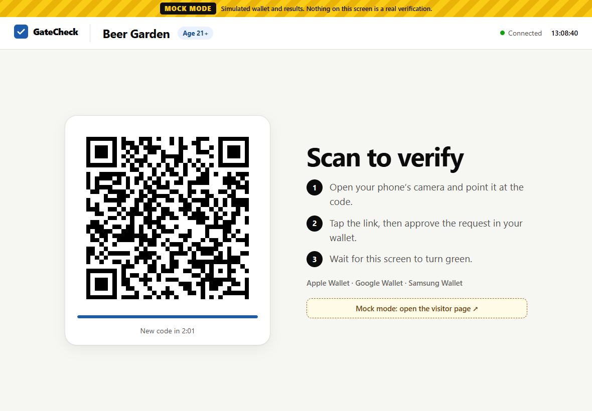
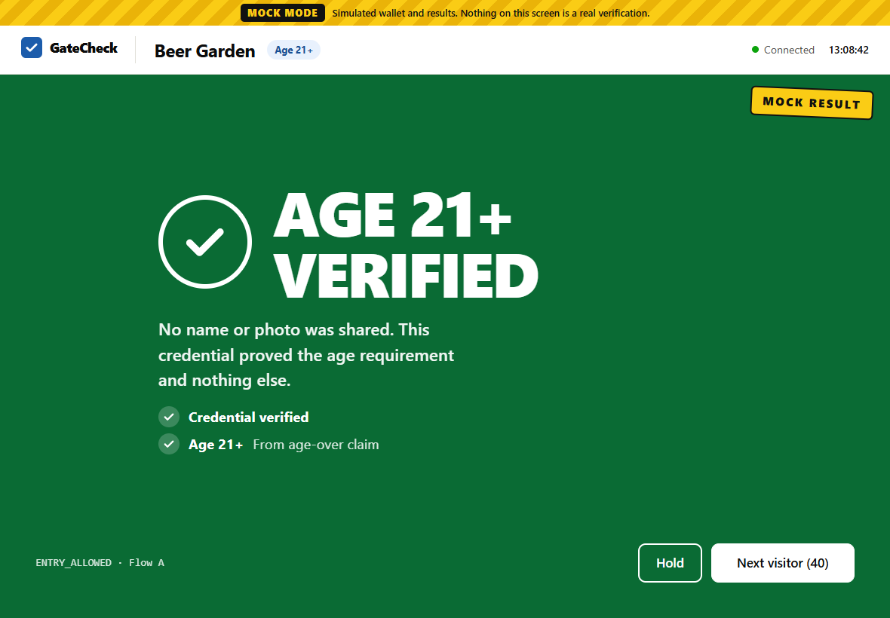
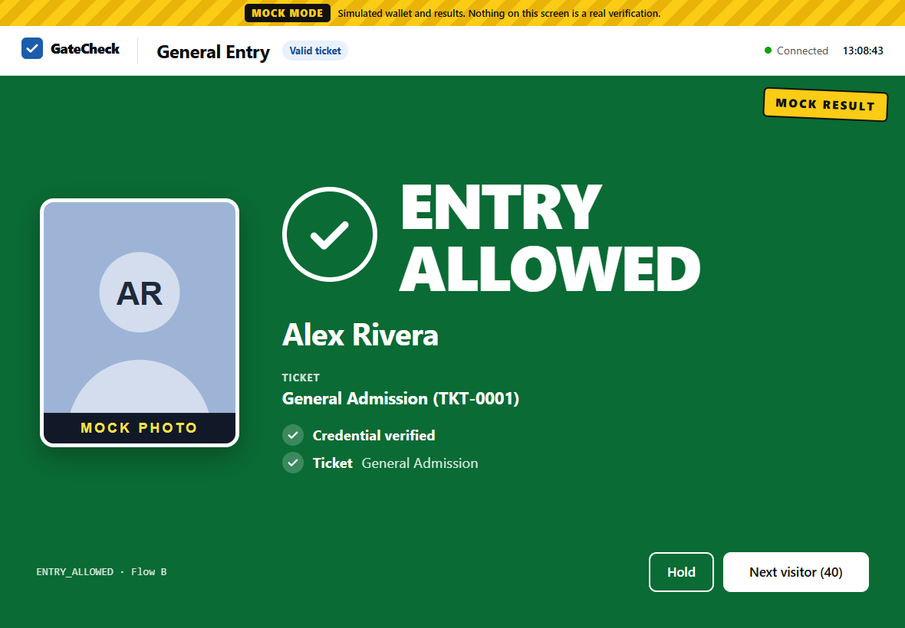
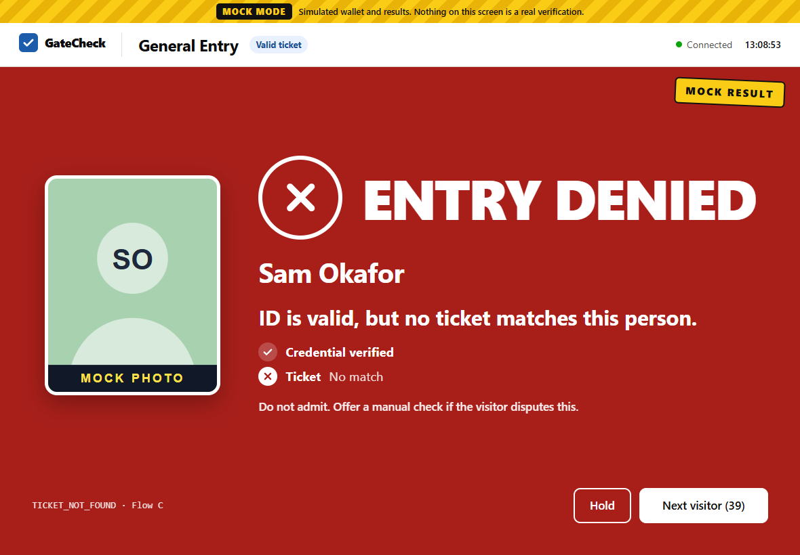
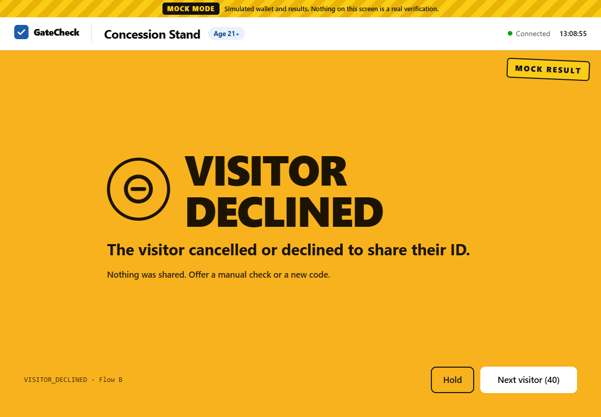
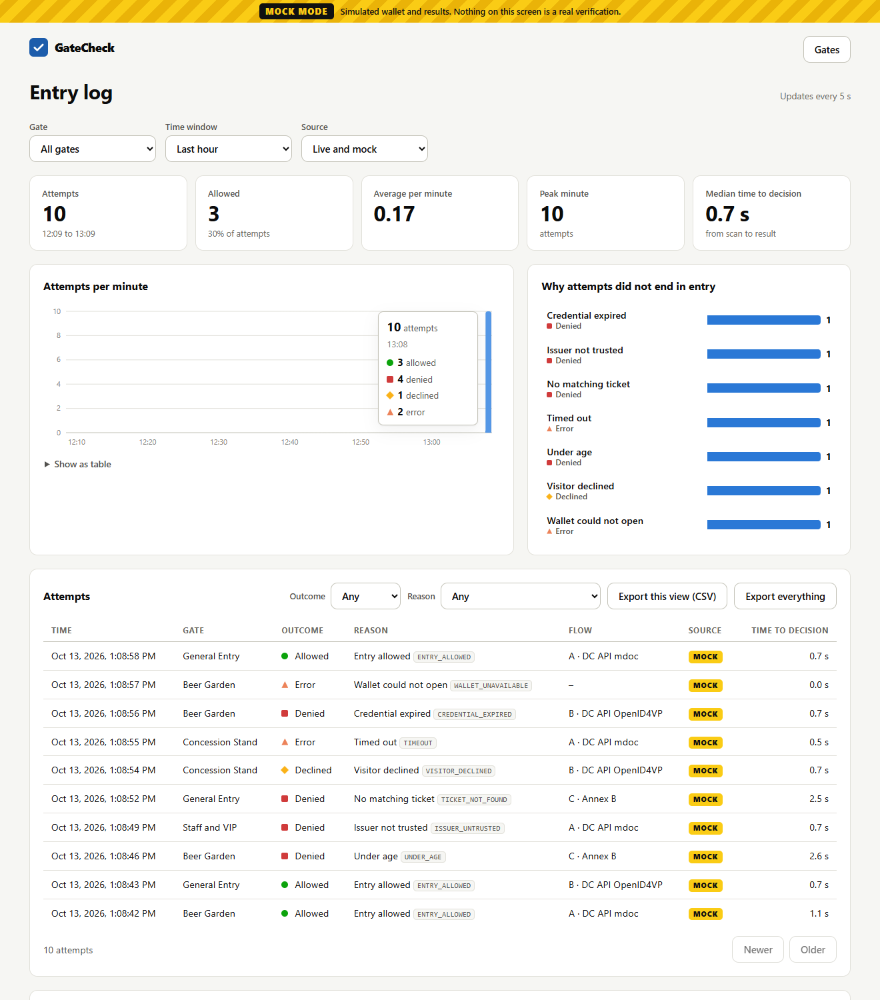
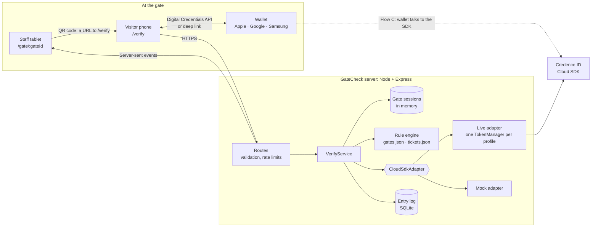
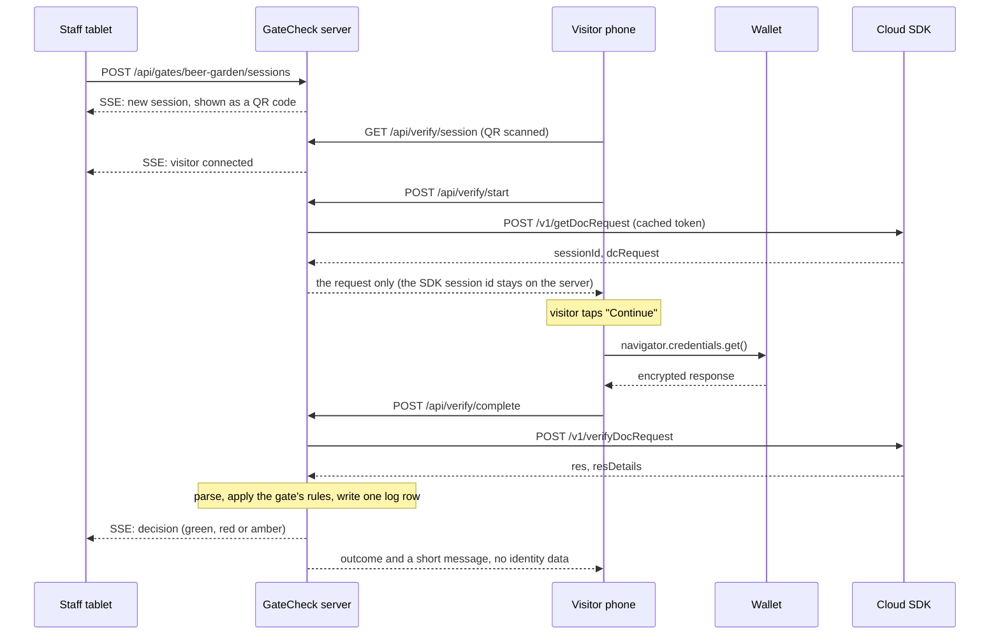

# GateCheck

A venue gate verification prototype built on the [Credence ID Cloud SDK](https://credenceid.com/mobile-id/developer-documentation/integration-guide/).

A staff tablet at each gate shows a QR code. A visitor scans it with their own phone, approves the request in Apple Wallet, Google Wallet or Samsung Wallet, and the tablet turns green, red or amber within a second or two. The decision on screen is the outcome of that gate's rule (a ticket match, an age limit, an allow-list), not just "the signature was valid".

It runs in two modes:

- **Live** calls the real Cloud SDK. It needs a license key, a profile ID, and a registered HTTPS origin.
- **Mock** swaps in a fake Cloud SDK and a simulated wallet, so every screen and rule can be exercised with no credentials, network or phone.

A banner on every page says which mode is active.

| Waiting for a scan | Age-only credential | Full ID with a ticket |
| --- | --- | --- |
|  |  |  |

| Valid ID, no ticket | Visitor declined | Entry log |
| --- | --- | --- |
|  |  |  |

Screenshots are from mock mode, which is why each carries the mock banner and stamp.

## Contents

- [Quick start](#quick-start)
- [How it works](#how-it-works)
- [Flows supported](#flows-supported)
- [Gates, profiles and rules](#gates-profiles-and-rules)
- [Configuration](#configuration)
- [What is stored](#what-is-stored)
- [Mock mode](#mock-mode)
- [Tests](#tests)
- [Deployment](#deployment)
- [Five-minute demo script](#five-minute-demo-script)
- [Where the docs and the sample disagree](#where-the-docs-and-the-sample-disagree)
- [What has and has not been verified](#what-has-and-has-not-been-verified)
- [Known limitations](#known-limitations)
- [Built with AI assistance](#built-with-ai-assistance)

## Quick start

Requires Node.js 22 or later.

```bash
npm install
npm run dev:mock        # mock mode, no credentials needed
```

Open <http://localhost:5180>. Pick a gate, then either:

- click **Mock mode: open the visitor page** under the QR code to play the visitor in a second tab, or
- scan the QR code with a phone on the same Wi-Fi. In mock mode the code encodes this computer's network address rather than `localhost`, and the gate screen shows the address it uses. If the phone cannot connect, check that both devices are on the same network and that the firewall allows Node.js to accept incoming connections.

To run against the real Cloud SDK:

```bash
cp .env.example .env    # then fill in the four values below
npm run smoke           # one /v1/setup call per profile; prints status only
npm run build && npm start
```

| Value | Where it comes from |
| --- | --- |
| `CREDENCE_LICENSE_KEY` | Verify with Credence portal |
| `CREDENCE_PROFILE_AGE_CHECK` | The profile ID used by the age gates |
| `REGISTERED_ORIGIN` | The exact `https://` origin you registered with Credence |
| `MOCK_MODE=false` | |

In live mode the server refuses to start if any of these is missing, and says which.

| Script | What it does |
| --- | --- |
| `npm run dev` | API on `:8787` and Vite on `:5180`, using `.env` |
| `npm run dev:mock` | The same, forced into mock mode |
| `npm run build` | Typecheck, build the web app, bundle the server into `dist/` |
| `npm start` / `npm run start:mock` | Serve the built app on one port |
| `npm run smoke` | Check credentials against `/v1/setup` |
| `npm test` | Unit and integration tests |

## How it works



One attempt, using Flow A as the example:



Design points worth knowing:

- **The QR code points at this app, not at a wallet.** It encodes `/verify?gate=…&session=…`. Every attempt gets a fresh, random session id, and the code rotates when it expires unscanned.
- **The browser never sees a secret.** The license key, access tokens, refresh tokens and the Cloud SDK session id all stay on the server. The visitor's phone is given only the request to hand to the wallet.
- **One interface to the Cloud SDK.** `CloudSdkAdapter` (`src/server/cloud/adapter.ts`) has a live and a mock implementation. Both feed the same response parsers, so mock mode runs the same code real responses will.
- **Tokens are cached per profile.** A token is bound to the profile it was issued for, so there is one `TokenManager` per profile ID. It reuses a token until 60 seconds before expiry, refreshes with the rotating refresh token, runs only one renewal at a time, falls back to `/v1/setup` when the refresh token is dead, and after a `429` waits out `Retry-After` instead of retrying. `/v1/setup` is never called per request.
- **Flow C is polled from the server.** While the visitor is in the wallet app their browser tab is in the background and its timers may not run, so the server polls `/openid4vp/v1/mdoc/result` every 2 seconds. The same-device `response_code` redirect is also handled and simply finishes sooner.
- **The request is fetched before the tap.** iOS Safari only allows `navigator.credentials.get()` inside the user's tap. The page therefore fetches the request on load and the tap handler calls the wallet with no `await` in front of it. This is the sample app's prefetch idea, moved from `pointerdown` to page load.

### Project layout

```
config/            gates.json, tickets.json (the rule configuration)
src/shared/        API types, reason codes, platform detection (pure, shared by both sides)
src/server/
  cloud/           adapter interface, live + mock adapters, token manager, parsers, error mapping
  rules/           gate config loading, profile resolution, the rule engine
  verifyService.ts one attempt end to end
  sessions.ts      in-memory gate sessions + SSE fan-out
  entryLog.ts      SQLite log, stats, CSV, purge
  app.ts           routes, validation, security headers
  smoke.ts         npm run smoke
src/web/           React app: gate screen, visitor page, admin
tests/             Vitest suites
```

## Flows supported

| | Flow A | Flow B | Flow C |
| --- | --- | --- | --- |
| Wallet | Apple Wallet | Google Wallet | Samsung Wallet |
| Transport | Digital Credentials API, `org-iso-mdoc` | Digital Credentials API, OpenID4VP | OpenID4VP Annex B deep link |
| Start | `POST /v1/getDocRequest` | `POST /dcapi/openid4vp/v1/initiate` | `POST /openid4vp/v1/mdoc/initiate` |
| Finish | `POST /v1/verifyDocRequest` | `POST /dcapi/openid4vp/v1/validate` | poll `POST /openid4vp/v1/mdoc/result`, or `GET …/resume` |
| Chosen for | Safari 17.4+ on iPhone | Chrome 141+ on Android | Samsung Internet, or any browser on a Samsung phone |

`/verify` picks the flow from the browser (`src/shared/platform.ts`, following the support matrix in the integration guide) and gives a specific instruction when it cannot proceed:

- In-app browsers (Instagram, Facebook, TikTok, any webview): "Open this page in Safari / Chrome".
- Chrome or Firefox on iPhone: "Open this page in Safari".
- Chrome 128 to 140 with the flag off: names the flag.
- Other Android browsers: "Open this page in Chrome", with Samsung Wallet offered as an alternative.
- Desktop: "Open this on your phone".

Flow D (W3C Verifiable Credentials) is not implemented.

Response handling follows the API reference:

- `resDetails` and `identity` are JSON **strings** and are parsed. Both the nested `{ identity, authentication }` layout and the flat layout shown in one of the reference examples are accepted.
- "Cancelled" is its own response shape (`{ cancelled: true }`) and is checked before `res`. It shows amber, never red.
- HTTP 200 can still be a failure (`res: false`, or `success: false` in Flow C).
- Flow B reports a failed credential as HTTP 400 `Validation failed: …`, which is treated as a failed credential rather than an error.
- In Flow C, `User denied consent.` is a decline and `Session timed out.` is a timeout; any other `success: false` is a failed credential.
- `401 / 403 / 429 / 5xx` are mapped to named reasons the staff screen can show (`SDK_AUTH_ERROR`, `SDK_DOMAIN_MISMATCH`, `SDK_PROFILE_ERROR`, `SDK_QUOTA_EXCEEDED`, `SDK_RATE_LIMITED`, `SDK_UNAVAILABLE`). A `401 TOKEN_EXPIRED` triggers one refresh and one retry. `500` is retried once and `502` twice, as the reference advises.

## Gates, profiles and rules

Gates are defined in `config/gates.json`. Each names the reader profile it needs and its rules:

```json
{
  "id": "general-entry",
  "name": "General Entry",
  "profile": "id-check",
  "rules": [{ "type": "ticket" }],
  "fallback": {
    "profile": "age-check",
    "notice": "Age check only",
    "rules": [{ "type": "age", "minAge": 21 }]
  }
}
```

| Gate | Profile | Rule |
| --- | --- | --- |
| `beer-garden`, `concession` | age-check | Age 21 or over |
| `general-entry` | id-check, falling back to age-check | Ticket match. On the fallback: age 21+, labelled "Age check only" |
| `vip` | id-check | Allow-list |

Profiles map to environment variables: `age-check` is `CREDENCE_PROFILE_AGE_CHECK`, `id-check` is `CREDENCE_PROFILE_ID_CHECK`. When a gate's profile is not configured it uses its `fallback` if it has one, and says so on screen. A gate with no fallback (the VIP gate) is disabled rather than silently weakened.

Rule types:

- **`ticket`** looks the holder up in `config/tickets.json`, by document number when the credential shared one, otherwise by family name + given name + birth date.
- **`age`** uses an `age_over_NN` boolean when the response contains one. If it does not, it computes the age from `birth_date` using today's date in `VENUE_TIMEZONE`. If neither is present it denies with `AGE_UNAVAILABLE`. The Cloud SDK docs do not say which of these a profile returns, so nothing is assumed.
- **`allowlist`** matches the holder against entries listed in the gate itself.

A gate can list several rules; all must pass, and the screen shows each one.

**The screens are driven by what actually came back.** An age-check profile may return a single age-over claim and nothing else. In that case the green screen reads **AGE 21+ VERIFIED** and states that no name or photo was shared. If a name and portrait are present, they are shown instead. A gate that needs to identify the holder but receives an age-only credential denies with `ATTRIBUTES_MISSING`.

To see what a profile really returns, open **Response shapes** on `/admin` (or `GET /api/admin/debug/shapes`). It lists the field names, never the values, of recent responses. The same line is written to the server console. In live mode the endpoint stays closed until `STAFF_PASSCODE` is set.

### Result screens

| Colour | Meaning | Examples |
| --- | --- | --- |
| Green | Verified and the rule allows entry | `ENTRY ALLOWED`, `AGE 21+ VERIFIED` |
| Red | The credential failed, or the rule said no | `CREDENTIAL_EXPIRED`, `ISSUER_UNTRUSTED`, `UNDER_AGE`, `TICKET_NOT_FOUND` |
| Amber | The visitor cancelled or declined | `VISITOR_DECLINED` |
| Slate | Could not verify; not a denial | `SDK_QUOTA_EXCEEDED`, `WALLET_UNAVAILABLE` |
| Grey | Timed out | `TIMEOUT` |

Each state also has its own icon and headline, so nothing depends on colour alone.

## Configuration

All settings are environment variables. `.env.example` documents each one.

| Variable | Default | Purpose |
| --- | --- | --- |
| `MOCK_MODE` | `false` | `true` uses the fake Cloud SDK |
| `CREDENCE_BASE_URL` | `https://credenceid.com/cloudsdk/playground` | Cloud SDK base URL |
| `CREDENCE_LICENSE_KEY` | | License key. Secret. Required in live mode |
| `CREDENCE_PROFILE_AGE_CHECK` | | Profile for the age gates. Required in live mode |
| `CREDENCE_PROFILE_ID_CHECK` | | Optional profile that returns name / portrait |
| `REGISTERED_ORIGIN` | | The `https://` origin registered with Credence. Required in live mode |
| `PORT` | `8787` | |
| `TRUST_PROXY` | `0` | Reverse-proxy hops to trust for client IPs |
| `STAFF_PASSCODE` | | Passcode for `/gate/*`, `/admin` and the debug endpoint |
| `SESSION_TTL_SECONDS` | `120` | How long a code or attempt lasts |
| `RESULT_DISPLAY_SECONDS` | `12` | How long a result stays up before the next code |
| `VENUE_TIMEZONE` | `UTC` | Decides "today" for age from a birth date |
| `DB_PATH` | `./data/gatecheck.sqlite` | Entry log |
| `LOG_RETENTION_DAYS` | `30` | Older rows are purged |
| `PURGE_INTERVAL_MINUTES` | `60` | How often the purge runs |
| `DC_MDOC_REQUEST_SHAPE` | `deviceRequest` | See [below](#where-the-docs-and-the-sample-disagree) |
| `DC_OPENID4VP_PROTOCOL` | `openid4vp` | See [below](#where-the-docs-and-the-sample-disagree) |

`.env` is gitignored. The license key is wrapped in a `Secret` type that prints as `[redacted]` if it is ever logged, serialised or interpolated, and the logger additionally scrubs anything that looks like a token or key.

`GET /health` reports mode, uptime, database status and whether a token is cached. It never calls the Cloud SDK.

## What is stored

One row per attempt, with exactly these fields:

| Field | Example |
| --- | --- |
| timestamp | `2026-10-13T18:30:20.000Z` |
| gate | `beer-garden` |
| outcome | `allowed`, `denied`, `declined`, `error` |
| reason code | `UNDER_AGE` |
| flow | `dc-mdoc` |
| latency | milliseconds from the visitor opening `/verify` to the decision |
| mode | `live` or `mock`, so simulated attempts can never be counted as real |

No name, birth date, portrait or document number is written anywhere. The table has no column that could hold one, and a test asserts that. The holder's name and photo exist only in memory, for the staff screen, and are dropped five minutes after the attempt ends.

Rows older than `LOG_RETENTION_DAYS` are deleted at startup and every `PURGE_INTERVAL_MINUTES`; `/admin` can also run the purge on demand.

`/admin` shows the log with filters (gate, time window, source, outcome, reason), attempts per minute, a breakdown of why attempts did not end in entry, and CSV export.

## Mock mode

`MOCK_MODE=true` (or `npm run dev:mock`) replaces the Cloud SDK with `MockCloudSdkAdapter` and the wallet with a sheet on the visitor page. The sheet chooses:

- **who is presenting**: four personas that between them pass and fail each gate;
- **what the profile releases**: a full ID, or the **age-only profile** (one `age_over_21` claim, no name or photo);
- **how it ends**: share, expired ID, untrusted issuer, tampered ID, decline, dismiss the prompt, or walk away (timeout).

Mock responses use the `{ identity, authentication }` shape and field names from the official sample app. The *values* of `msoValidity` and the failure texts are invented, because the docs do not specify them.

Mock mode is hard to miss: a striped banner on every page, a `MOCK RESULT` stamp on every result, a `MOCK PHOTO` band on portraits, and a `MOCK` tag on every log row. In live mode `/admin` starts filtered to live rows only.

## Tests

```bash
npm test
```

| Suite | Covers |
| --- | --- |
| `rules.test.ts` | Age arithmetic (birthdays, leap days, timezones), age-over claims, ticket and allow-list matching, every decision path |
| `tokenManager.test.ts` | Reuse, the 60-second margin, refresh-token rotation, fallback to setup, the 7-day sliding window, single-flight renewal, 429 back-off |
| `parse.test.ts` | Every response shape for Flows A, B and C, cancellation, failure classification, error mapping |
| `liveAdapter.test.ts` | The real adapter against a local HTTP server playing the Cloud SDK: headers, per-profile tokens, retries, error mapping |
| `verifyService.test.ts` | Whole attempts through the service: all gates and flows, timeouts, resets, polling, and that no personal data reaches the log |
| `entryLog.test.ts` | Columns, filters, stats, purge, CSV escaping |
| `config.test.ts` | Fail-fast messages, secret redaction, log scrubbing, profile fallback |
| `platform.test.ts`, `walletData.test.ts` | Browser detection and wallet response handling |

## Deployment

GateCheck is one process serving the API and the built web app on one port. It needs:

1. **An HTTPS origin, registered with Credence.** `REGISTERED_ORIGIN` must match it exactly. The Digital Credentials API only works in a secure context, and the Cloud SDK rejects any other origin with `DOMAIN_MISMATCH`.
2. **A single instance.** Gate sessions, SSE connections and the token cache live in memory. To run more than one instance they would need a shared store (Redis, for example) and sticky SSE routing.
3. **A persistent disk** mounted where `DB_PATH` points, or the log is lost on redeploy.
4. **A proxy that does not buffer server-sent events.** The app sends `X-Accel-Buffering: no` and a keep-alive every 20 seconds. Set `TRUST_PROXY=1` behind one proxy so rate limiting sees real client IPs.
5. **`STAFF_PASSCODE` set.** Without it the gate screens and admin page are open to anyone who can reach the host.

With Docker:

```bash
docker build -t gatecheck .
docker run -d --name gatecheck -p 8787:8787 -v gatecheck-data:/data \
  -e MOCK_MODE=false \
  -e CREDENCE_LICENSE_KEY=... \
  -e CREDENCE_PROFILE_AGE_CHECK=... \
  -e REGISTERED_ORIGIN=https://gate.example.com \
  -e STAFF_PASSCODE=... \
  -e TRUST_PROXY=1 \
  gatecheck
```

Pass secrets as environment variables or your host's secret store. No `.env` file is copied into the image.

Put TLS in front. With [Caddy](https://caddyserver.com) on the same machine the whole config is:

```
gate.example.com {
    reverse_proxy localhost:8787
}
```

Any container host works the same way (one instance, a volume at `/data`, the variables above as secrets). After deploying:

```bash
npm run smoke                         # from a machine with the same .env
curl https://gate.example.com/health
```

To demo from a laptop, an HTTPS tunnel with a stable hostname also works, as long as that hostname is the origin registered with Credence and the gate screen is opened on it.

## Five-minute demo script

1. **(0:00)** Home page: four gates, the profile each one uses, the mode banner.
2. **(0:30)** Open **Beer Garden** on the "tablet". Scan the QR with a phone (or open the visitor page in a second window). The tablet shows "Visitor connected".
3. **(1:00)** Approve. The tablet turns green: **AGE 21+ VERIFIED**, "No name or photo was shared".
4. **(1:30)** Next visitor, under 21: red, **ENTRY DENIED**, `UNDER_AGE`.
5. **(2:00)** Decline in the wallet: amber, **VISITOR DECLINED**. Then walk away: grey, **TIMED OUT**.
6. **(2:45)** **General Entry** with a full ID: green with name, photo and ticket. Then someone with a valid ID and no ticket: red, "ID is valid, but no ticket matches this person". This is the rule layer deciding, not the signature.
7. **(3:30)** An expired or untrusted credential: red, with the failed check listed.
8. **(4:00)** `/admin`: attempts per minute, the reason breakdown, filter by clicking a reason, export CSV, and the "Response shapes" panel showing field names only.
9. **(4:40)** Point out what is stored (seven fields, no personal data) and the retention purge.

In mock mode every step works from the wallet sheet. In live mode steps 2, 3 and 5 work with a real wallet; the rest depend on which credentials and profiles you have.

## Where the docs and the sample disagree

The integration guide and the [official sample app](https://github.com/CredenceID/React-CloudSDK-Integration) differ in three places. GateCheck defaults to the guide and makes each one a setting, because neither could be confirmed without a real wallet.

| | Integration guide (default) | Sample app | Setting |
| --- | --- | --- | --- |
| Flow A `data` | `dcRequest.deviceRequest` | the whole `dcRequest` object | `DC_MDOC_REQUEST_SHAPE=dcRequest` |
| Flow B protocol | `openid4vp` | `openid4vp-v1-unsigned` | `DC_OPENID4VP_PROTOCOL=openid4vp-v1-unsigned` |
| Flow B wallet response | a string in `credential.data` | `credential.data.response` | none needed: both are handled |

If Apple Wallet or Google Wallet does not open on a real phone, these two settings are the first things to try.

Other things the docs leave open, marked `TODO(live)` in the code:

- **Failure texts.** The reference says a failed result carries "a human-readable error description" without listing them. `classifyFailure` maps to expired / untrusted / invalid from the `authentication` flags named in the sample's types, then from keywords. Confirm against real failures.
- **Which attributes a profile returns.** Not documented, so every rule copes with a field being absent.
- **License key format.** The reference says keys start with `CS-`; issued keys can look different, so the format is not validated. `/v1/setup` is the judge.

## What has and has not been verified

Verified during development (the browser runs used throwaway scripts that are not part of this repository):

- The unit and integration suites pass.
- In **mock mode**, every gate, flow and outcome was driven through the real UI in headless Chrome, at tablet and phone sizes.
- In **live mode against a local stand-in for the Cloud SDK**, with `navigator.credentials.get` stubbed in the page: Flows A, B and C, the same-device resume, cancellation and failure shapes, error mapping, token refresh, and unsupported-browser messages. Checked there: `credentials.get` is called with exactly the arguments the guide specifies and inside the user gesture; `/v1/setup` is called once for the whole run; every call carries `Origin`; the server log contains no key, token, wallet data or claim value.

Not verified, because it needs the real service or a real phone:

- A real `/v1/setup` with the real key and origin. Run `npm run smoke`.
- Apple Wallet on iOS Safari: that the prefetch keeps the call inside the user gesture on a real device, and which `data` shape Safari wants.
- Google Wallet on Android Chrome: the protocol identifier and the shape of `credential.data`.
- Samsung Wallet: that the deep link opens from the tap, that the wallet redirects to the return URL, and how the `response_code` arrives.
- What cancelling looks like in each real wallet (which error the browser raises, or which response the SDK returns).
- What the age-check profile actually returns, and the text of real failures.
- The Docker image has not been built here (no Docker on the build machine).

## Known limitations

- **Needs a network.** Verification is a call to the Cloud SDK. With no connectivity the gate shows "Could not verify" and staff fall back to a manual check. There is no offline mode.
- **Monthly quota and rate limits.** The plan has a monthly verification quota (`429 PLAN_LIMIT_EXCEEDED`) and `/v1/setup` is limited to 30 calls a minute per IP. GateCheck caps Cloud SDK requests at three per attempt and never calls setup per request, but a busy venue should check its plan.
- **The visitor needs an ID in a wallet.** That means a supported state mobile ID in Apple Wallet, Google Wallet or Samsung Wallet. There is no fallback for visitors without one beyond the manual check.
- **Browser support is narrow.** Safari 17.4+ on iPhone, Chrome 141+ on Android (128 to 140 with a flag), Samsung Internet. Firefox and in-app browsers cannot use the Digital Credentials API.
- **Single instance.** Sessions and tokens are in memory; a restart drops in-flight attempts (the tablet recovers by itself with a new code).
- **Detection is best-effort.** Chrome hides the device model, so a Samsung phone on Chrome is recognised only when client hints are available; the page offers the other wallet as an alternative either way.
- **Staff access is a shared passcode**, not per-user accounts, and ticket and allow-list data are JSON files, not a ticketing system.
- **Prototype scope.** No Flow D, no multi-document presentations, no accessibility audit beyond contrast, focus and labels.

## Built with AI assistance

This project was built with AI assistance (Claude, via Claude Code). The AI read the Cloud SDK documentation and the official sample, proposed the design, and wrote the code, tests and this README under my direction. I set the requirements, supplied the credentials and profile configuration, and reviewed the result. The "not verified" list above is the honest boundary of what has been tested: anything involving a real wallet still has to be checked on a real phone.
